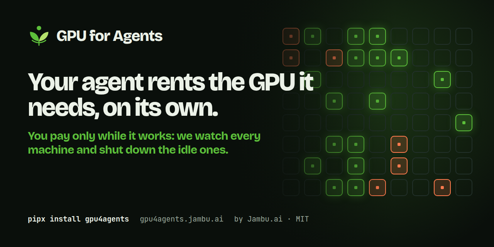

<p align="center">
  <a href="https://gpu4agents.jambu.ai">
    
  </a>
</p>

<p align="center">
  <a href="https://pypi.org/project/gpu4agents/"></a>
  <a href="https://pypi.org/project/gpu4agents/"></a>
  <a href="https://github.com/jambuai/gpu4agents/actions/workflows/ci.yml"></a>
  <a href="LICENSE"></a>
</p>

<p align="center">
  <a href="https://gpu4agents.jambu.ai">Website</a> ·
  <a href="https://gpu4agents.jambu.ai/#video">1-minute video</a> ·
  <a href="docs/AGENTS.md">Agents guide</a> ·
  <a href="https://github.com/jambuai/gpu4agents/wiki">Wiki</a> ·
  <a href="CHANGELOG.md">Changelog</a>
</p>

# GPU for Agents

**Your agent rents the GPU it needs, on its own.**
**You pay only while it works: we watch every machine and shut down the idle ones.**

Ask Claude Code, Codex, Gemini CLI or Cursor to "compare Qwen 7B and Llama 8B on these 50 prompts". The agent finds a GPU under your budget, serves the model with vLLM behind an OpenAI-compatible API, and runs the experiment. A watchdog on the machine shuts it down after `idle_timeout` (15 minutes by default) with nothing using it, even if the agent forgot, the chat closed or your laptop is asleep.

The agent installs it from one pasted line. A skill and local MCP tools (`gpu_offers`, `gpu_setup`, `gpu_run`, `gpu_status`, `gpu_destroy`, ...) cover the whole lifecycle, and the skill tells the agent to show you the price and ask before renting. Budgets, a maximum lifetime and an account-wide sweep catch anything left behind. Apps in any language get the endpoint from `gpu --json setup`.

Vast.ai is built in. Any other GPU provider takes one adapter file, and your agent can write it: see [Use any GPU provider](#use-any-gpu-provider).

## Installation

The quickest way works in every agent. Paste this, naming the agent you use:

```text
Set up GPU for Agents for me. I'm using Claude Code. Fetch https://gpu4agents.jambu.ai/install.md with curl and follow its steps.
```

The agent installs the `gpu` command (with [uv](https://docs.astral.sh/uv/), which brings its own Python), the `gpu4agents` skill and the `gpu` MCP tools. It rents nothing.

You can also install the skill the way your agent installs other skills. The skill installs the `gpu` command the first time it runs.

### Claude Code

```text
/plugin marketplace add jambuai/gpu4agents
/plugin install gpu4agents@gpu4agents
```

On Claude Code 2.1.275 or newer, one line does both: `/plugin install gpu4agents --marketplace jambuai/gpu4agents`.

### Codex

```bash
npx skills add jambuai/gpu4agents --global --agent codex
```

### Gemini CLI, Cursor and other agents

```bash
npx skills add jambuai/gpu4agents --global --agent '*'
```

This installs the skill for every agent the [Skills CLI](https://skills.sh) supports. Leave off `--global` to install it only in the current project.

### Claude.ai and Claude Desktop

Download [`gpu4agents-skill.zip`](https://github.com/jambuai/gpu4agents/releases/latest/download/gpu4agents-skill.zip) and upload it under Settings > Capabilities > Skills.

### From a terminal

```bash
curl -fsSL https://gpu4agents.jambu.ai/install.sh | sh              # uv, Python and gpu, then every agent it finds
uv tool install gpu4agents && gpu agent install -t auto --global    # the same, by hand
```

## Connect a GPU provider

Run this in your own terminal, so the agent never sees the key:

```bash
gpu login                     # Vast.ai: paste a key from https://cloud.vast.ai/manage-keys/
gpu login --provider runpod   # a provider you added an adapter for
gpu login --check             # which account gpu finds, and its balance
```

`gpu login` checks the key with the provider, then saves it in `~/.gpu/credentials` (mode 600). Keys in the environment or a project `.env` work too. They never go in `jambu.yaml`.

Restart the agent and ask for an experiment. See [Letting a coding agent rent GPUs](docs/AGENTS.md).

## Run your own code on the GPU

Serving a model is one use. A **job** is any program: training a LoRA, generating images or audio with an open model, a batch over a dataset, a CUDA benchmark. The agent writes the code in a directory, and `gpu` uploads it, runs it on the rented machine, streams the log and brings back whatever it wrote to `$JAMBU_OUTPUT_DIR`. The machine stays up while the job runs and stops by itself after it ends.

```bash
gpu init --jobs --min-vram-gb 24          # a machine that runs jobs, no model server
gpu job run -- python train.py --epochs 3 # upload, run, follow, download to gpu-outputs/<job id>/
gpu job status                            # state, exit code, time, cost
```

To have the agent write one, paste:

```text
Write this as a GPU for Agents job and run it. Fetch https://gpu4agents.jambu.ai/jobs.md with curl and follow its contract.
```

[JOBS.md](JOBS.md) has the contract: the directory, `gpujob.yaml`, the environment a job gets, and the rules its code follows.

## Serve any model

Give `gpu` a Hugging Face model id and it serves it behind the OpenAI API shapes, whatever the model does. It reads the model card: chat and vision-language models run on vLLM; image, voice, transcription, embedding and other pipeline models run on gpu's own server. Any OpenAI client then works unchanged.

```bash
gpu init --model stabilityai/sd-turbo      # text-to-image -> /v1/images/generations
gpu init --model openai/whisper-large-v3   # speech recognition -> /v1/audio/transcriptions
gpu init --model BAAI/bge-m3               # embeddings -> /v1/embeddings
gpu setup && eval "$(gpu env)"             # OPENAI_BASE_URL, OPENAI_API_KEY, JAMBU_MODEL_ID
```

Requests count as activity, so the machine stays up while clients call it and stops by itself once they stop. Pointing `model.id` at another model and running `gpu setup` again swaps the model on the same GPU, with no new rental. When no built-in server can load a model, `gpu init --engine custom` writes a small server for the agent to fill in, and gpu runs it the same way. [SERVING.md](SERVING.md) has the contract, the routes and the limits.

## Use any GPU provider

`gpu` talks to providers through a small contract: find offers, rent, report status, stop, destroy, and two calls the watchdog makes from the machine to shut itself down. Vast.ai ships with it. For anything else, such as RunPod, Lambda or your company's cluster, paste this into your agent:

```text
Add <provider> to GPU for Agents. Fetch https://gpu4agents.jambu.ai/providers.md with curl and follow its steps.
```

The agent runs `gpu providers new <name>`, fills in the adapter from the provider's API docs, checks it with `gpu validate` and `gpu offers`, and asks you before a test rental. The adapter is one file in your project, selected in `jambu.yaml`:

```yaml
gpu_runtime:
  provider:
    name: runpod
    plugin: ./gpu_providers/runpod.py:RunpodProvider
```

To reuse an adapter across projects, publish it as a package with a `gpu4agents.providers` entry point. The watchdog, budgets, CLI and MCP tools work the same with every provider. See [PROVIDERS.md](PROVIDERS.md) and [Adding a provider](docs/ADDING_A_PROVIDER.md).

## Quickstart: from a shell or an app

```bash
gpu init --model Qwen/Qwen2.5-7B-Instruct
gpu validate
gpu offers                         # see prices, rent nothing
gpu setup                          # rent, boot vLLM, wait until the model answers
gpu run python experiment.py       # OPENAI_BASE_URL / OPENAI_API_KEY are set for the job
gpu destroy                        # or walk away: the idle timeout does it
```

From an application in any language, `gpu --json setup` prints the endpoint as JSON. See [Integrating into an application](docs/INTEGRATION.md), with a ready TypeScript client.

## Declare the limits

```yaml
# jambu.yaml (only the gpu_runtime key is read, so other Jambu tools can share the file)
gpu_runtime:
  provider: {name: vast}
  model_profile: qwythos-9b
  lifecycle:
    idle_timeout: 15m          # the watchdog on the machine stops it
    max_lifetime: 6h           # a hard ceiling, busy or not
  budget:
    max_hourly_cost_usd: 0.60  # offers above this are never rented
    max_session_cost_usd: 5.00
  health:
    pull_stall_timeout: 10m    # a host whose image pull stalls is replaced
```

A full example is [`jambu.example.yaml`](jambu.example.yaml). `gpu ls` shows every machine billing in the account, and `gpu sweep --install-timer` guards every project on the machine and cleans up orphans. See [Keeping the account clean](docs/USAGE.md#keeping-the-account-clean).

## Docs

- [Letting a coding agent rent GPUs (Claude Code, Codex, Gemini CLI, Cursor, Claude Desktop)](docs/AGENTS.md)
- [Integrating into an application (any language)](docs/INTEGRATION.md)
- [Running your own code as a job](JOBS.md)
- [Commands, workloads, and agents](docs/USAGE.md)
- [Every config field](docs/CONFIG.md)
- [Choosing a model](docs/CHOOSING_A_MODEL.md)
- [How shutdown works](docs/LIFECYCLE.md)
- [Adding a provider](docs/ADDING_A_PROVIDER.md), and [the steps for an agent](PROVIDERS.md)

## Coming from `jambu-gpu`

The package was called `jambu-gpu` until 0.4.1. The code, the `gpu` command, `jambu.yaml` and the machines are the same:

```bash
pipx uninstall jambu-gpu && pipx install gpu4agents
```

Sweep timers installed by `jambu-gpu` keep working; `gpu sweep --install-timer` rewrites them for the new module.

## Contributing

Issues and pull requests are welcome. Read [CONTRIBUTING.md](CONTRIBUTING.md) and the [Code of Conduct](CODE_OF_CONDUCT.md). Report security issues privately, as described in [SECURITY.md](SECURITY.md).

## Author

Created by [João Gabriel Lima](https://www.linkedin.com/in/joaogabriellima) at [Jambu.ai](https://jambu.ai).

## License

[MIT](LICENSE).

<p align="center">
  <a href="https://jambu.ai">
    
  </a>
</p>
